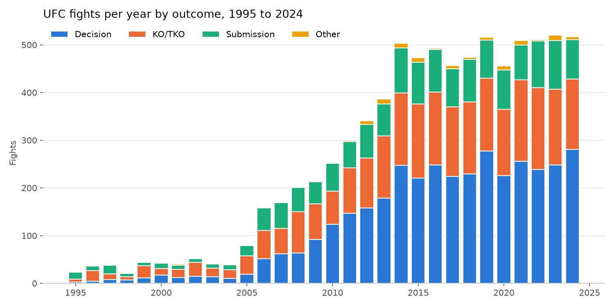

<h1 align="center">UFC Fight Data Scraping</h1>

<p align="center">
  A Scrapy spider that collects fight-level and round-by-round stats for every UFC event on ufcstats.com, plus a script that cleans them into an analysis-ready table.
</p>

<p align="center">
  
  
  <a href="LICENSE"></a>
</p>



## Overview

[ufcstats.com](http://ufcstats.com) has detailed stats for every UFC fight, but no API or download. This project scrapes it into CSV files I can reuse in later ML projects.

The saved scrape covers 724 events and 8,066 fights from July 14, 1995 to April 12, 2025. Across 1995 to 2024, 46.7% of fights went to a decision, 32.6% ended by KO/TKO, 19.4% by submission and 1.4% some other way (DQ, overturned, etc.).

The raw scraped data is included in the repo because ufcstats.com now blocks scrapers with a bot check, so it can't be collected again for now (see [Limitations](#limitations)). The cleaned file isn't included: the wrangling script rebuilds it from the raw data in seconds.

## What it collects

Each row in `scraped_fight_details.csv` is one fight, with fighter 1 and fighter 2 as `_1` and `_2` columns.

- **Fight details.** Event date and location, fighter names, nicknames, win/loss, division, method, last round, time in the last round, time format, referee and stoppage details.
- **Overall stats** for each fighter. Knockdowns, significant strikes (landed of attempted, and %), total strikes, takedowns (landed of attempted, and %), submission attempts, reversals and control time.
- **Significant strikes by target and position** for each fighter. Head, body, leg, distance, clinch and ground.
- **Round-by-round stats.** The overall stats and significant strike breakdown for rounds 1 to 5 (`r1_` to `r5_` columns). Rounds a fight didn't reach are empty.

`scraped_event_links.csv` has the link to each event page.

## How it works

`scripts/web_scraping.py` runs one Scrapy spider in three steps:

1. Open the completed events list and follow every event link.
2. On each event page, read the date and location, then follow every fight link.
3. On each fight page, read the fight details and the four stats tables (overall, overall by round, significant strikes, significant strikes by round) into one row.

Fights with no stats tables (some 1990s fights) are kept with empty stats and `stats_available` set to false. Pages that fail to parse are saved with an `error` column instead of being dropped silently.

`scripts/data_wrangling.py` turns the raw strings into numbers:

- Splits every `X of Y` column into `_landed` and `_attempted` columns.
- Converts percentages to fractions and `M:SS` times to seconds.
- Parses dates, strips whitespace, drops error rows and duplicate fights.
- Adds `time_format_rounds` and `total_fight_time_seconds`, using the round lengths from the time format (older fights had 10 to 20 minute rounds and overtime).

`scripts/make_charts.py` makes the chart above from the wrangled data.

## Usage

```bash
git clone https://github.com/Yahlawat/UFC_Data_WEBSCRAPING.git
cd UFC_Data_WEBSCRAPING

python3 -m venv .venv
source .venv/bin/activate

pip install -r requirements.txt
```

The raw scraped data is already in `data/scraped/`. Build the cleaned file and the chart from it:

```bash
python scripts/data_wrangling.py   # saves data/wrangled/
python scripts/make_charts.py      # saves images/fights_per_year.png
```

For a quick look at both formats without running anything, open the 100-fight sample in `data/sample/`.

To scrape fresh data (overwrites `data/scraped/`):

```bash
python scripts/web_scraping.py
```

A full scrape makes about 8,800 requests. At one request per second (see below) that takes around 2.5 hours.

> [!WARNING]
> As of October 2026, ufcstats.com answers the scraper with a JavaScript bot check ("Checking your browser") instead of the events page, so a new scrape currently stops with an error and saves nothing. Use the saved data in `data/scraped/`. See [Limitations](#limitations).

## Data

| File | Rows | Columns | In the repo | What it is |
|------|-----:|--------:|:-----------:|------------|
| `data/scraped/scraped_event_links.csv` | 724 | 1 | Yes | Event page links |
| `data/scraped/scraped_fight_details.csv` | 8,090 | 198 | Yes | Raw scraped fights, all values as text |
| `data/wrangled/wrangled_fight_details.csv` | 8,066 | 305 | No, run `data_wrangling.py` | Cleaned fights with numeric columns |
| `data/sample/sample_scraped_fight_details.csv` | 100 | 198 | Yes | Random sample of the raw fights (1996 to 2025) |
| `data/sample/sample_wrangled_fight_details.csv` | 100 | 305 | Yes | The same 100 fights after wrangling |

The 24 rows dropped during wrangling are fights the old version of the spider couldn't parse: 19 from 1995 to 1998 (likely no stats tables on the page) and 5 from the April 12, 2025 event (likely stats not posted yet when it was scraped). The current spider keeps fights without stats instead of erroring.

## Responsible scraping

- **Rate limit.** One request per second at most (`DOWNLOAD_DELAY = 1`), two concurrent requests, and AutoThrottle to back off when the site slows down.
- **Retries.** Failed requests are retried up to 3 times.
- **Honest user agent.** The spider identifies itself with a link to this repo instead of pretending to be a browser.
- **robots.txt.** `ROBOTSTXT_OBEY` is on.
- **Terms.** The stats belong to the UFC. Read ufcstats.com's terms before scraping, keep runs infrequent, and use the saved data in `data/scraped/` instead of re-scraping.

## Limitations

- **UFC 1 to 5 are missing from the saved scrape and the sample.** That scrape used a fixed page count that cut off the oldest events (November 1993 to April 1995). The spider now loads every event on one page (`?page=all`), so a new scrape should include them once the site can be scraped again.
- **No judges' scores in the saved scrape or the sample.** The old spider only kept the last line of the details field, so `stoppage_details` is empty for every decision. The spider now saves the full scorecards, but this also needs a re-scrape.
- **Blocked by a bot check (October 2026).** ufcstats.com now puts a JavaScript challenge in front of its pages, which Scrapy can't run. The spider detects it and stops with an error instead of saving empty files. It doesn't try to get around the check, and you shouldn't either: ask the site owner for access or use an existing copy of the data.
- **Tied to the page layout.** The parsers use CSS selectors and fixed column positions. If ufcstats.com changes its HTML, the spider will need updating.
- **Fighter 1 isn't always the winner.** Fighter order follows the page, so use `win_loss_1` and `win_loss_2` for the result.
- **Snapshot.** The data stops at April 12, 2025.

## Project structure

```
.
├── scripts/
│   ├── web_scraping.py      # Scrapy spider, saves data/scraped/
│   ├── data_wrangling.py    # Cleans the scraped data, saves data/wrangled/
│   └── make_charts.py       # Saves the chart in images/
├── data/
│   ├── scraped/             # Raw scraped CSVs (included)
│   ├── wrangled/            # Cleaned CSV (made by the wrangler, not tracked)
│   └── sample/              # 100-fight sample of raw and cleaned data
├── images/                  # Charts
├── requirements.txt
├── LICENSE
└── README.md
```

## License

The code is released under the [MIT License](LICENSE). The fight data in `data/` was collected from ufcstats.com and belongs to the UFC. It's included for research and educational use only and isn't covered by the MIT License.
